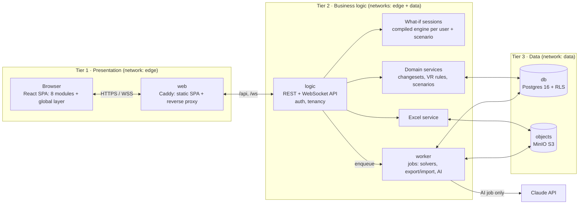

# 01 · Architecture overview (v1.1, three-tier)

Glidepath is a multi-tenant what-if app for airline IT cost reduction. AA is the first tenant. v1.1 redesigns v1.0 as a **strict three-tier architecture**: presentation, business logic and data are separate tiers, separate containers and separate networks. The UX (`/mnt/project-files/ux/`) is unchanged.

Inputs: `/mnt/project-files/model-spec/` (step 1) and `/mnt/project-files/ux/` (step 2).

## 1. The three tiers

| Tier | Container(s) | Holds | Never holds |
|---|---|---|---|
| **1 · Presentation** | `web` (Caddy serving the built React SPA and proxying `/api` and `/ws` to tier 2) | Layout, components, theme, animation, URL state, the slider thumb position while dragging, display formatting | Formulas, the engine, solvers, validation rules, Excel logic, scenario logic, SQL, credentials |
| **2 · Business logic** | `logic` (HTTP + WebSocket API) and `worker` (jobs). Same image, different command | Engine, solvers, domain rules (changesets, VR01–VR10, scenario fork/undo), Excel template/diff, AI reconfiguration, tenancy and authorisation | Pixels, DOM, styling |
| **3 · Data** | `db` (Postgres 16 with row-level security), `objects` (MinIO, S3-compatible) | Inputs, scenarios, changesets, calc and solver results, workbooks, AI audit files | Business rules beyond integrity constraints and RLS |

Rules that make this real, not nominal:
1. Tier 1 talks only to tier 2, over HTTPS/WSS using the published contract (`contract/api-contract`). Tier 2 is the only client of tier 3.
2. Docker networks enforce it: `web` is on network `edge` only; `logic` and `worker` are on `edge` and `data`; `db` and `objects` are on `data` only. The browser cannot reach the database even by mistake.
3. Build rules enforce it: `tier1-presentation/web` may import only `contract/api-contract` and `tier1-presentation/ui`. A CI check fails if the web bundle contains engine, solver, domain or excel code.
4. Every number the UI shows comes from tier 2. The UI may clamp a slider to the min/max that tier 2 sent with the variable definition (that is display metadata, not a business rule); tier 2 still validates.

## 2. Requirements map

| # | Requirement | How it is met |
|---|---|---|
| R1 | Every number is an editable input | Numbers are rows in tier 3 (`variable_value`, `scenario_value`). Tier 2 serves definitions; tier 1 renders controls from them. |
| R2 | Database-backed | Postgres in tier 3 is the system of record. |
| R3 | Excel export/import, app-defined template, delta detection | Tier 2 `excel` module: three-way diff (export snapshot, workbook, database), one changeset on apply. |
| R4 | Multi-tenant, AI reconfigures for UA or AS | `tenant_id` + RLS in tier 3; formulas and dimensions are data; the AI job in tier 2 writes only a reviewable changeset. |
| R5 | Solvers, optimizers, simulators | Tier 2 engine (incremental + vectorised) with solvers on top; long runs as jobs in `worker`. |
| R6 | Polished minimalist glass UX, unchanged | Tier 1 implements `ux/` as is. |
| R7 | Slider feels live; full eval < 50 ms; Monte Carlo 2,000 < 10 s | A per-user **what-if session** in tier 2 holds the compiled model in memory; previews stream over WebSocket (03 §2, 07 §3). |
| R8 | Three tiers, business logic separate from UI | §1 above. |
| R9 | Runs in Docker on the Mac now, portable to any cloud later | One `docker-compose.yml`, multi-arch images, config by environment variables only (11). |
| R10 | Demo-grade by Fri 4 Dec 2026 | One language, one repo, local stack on the Mac needs no internet for the demo. |
| R11 | Backlog with model and effort; subagent builds under an Opus orchestrator | Tiers and packages are the unit of work (10, `prompts/`). |

## 3. System diagram

## 4. Key decisions (ADR summary)

| ADR | Decision | Why | Rejected |
|---|---|---|---|
| 001 | **Strict three tiers** as in §1, enforced by networks and build rules | User requirement; keeps business logic testable, swappable and reusable (e.g. a future Excel add-in or API clients use the same tier 2) | Logic in the browser (v1.0), two-tier UI + DB |
| 002 | **TypeScript in all tiers** (pnpm + Turborepo monorepo) | One language for subagents; shared contract types between tier 1 and 2. Tier 2 could be re-implemented in another language behind the same contract later | Python tier 2 (second toolchain; the reference engine stays as the parity oracle) |
| 003 | **Engine runs only in tier 2**; per-user what-if sessions keep it warm in memory | Preserves the live slider without putting logic in the UI. Locally (Docker on the Mac) round trip is ~2–5 ms + eval | Engine in a browser worker |
| 004 | **Previews over WebSocket, commits over REST** | Drag sends coalesced previews (latest value wins, ≤ 30/s); release commits a changeset. Previews never write to the DB | REST per frame |
| 005 | **Port `reference/engine.py` to a compiled TS evaluator** | Proven math (245/245); golden results as acceptance | Re-deriving formulas |
| 006 | **Postgres 16 + RLS, Drizzle, migrations generated from `schema.json`** | Spec defines tables, views, RLS | Hand-written schema |
| 007 | **Every write is a changeset** via `applyChangeset()` in tier 2 | One path for UI, Excel, solver, AI, seed | Per-feature writes |
| 008 | **Jobs on Postgres (pg-boss)** in the `worker` container | No extra infrastructure | Redis |
| 009 | **Tier 1: React 19 + Vite SPA, TanStack Router (URL state), TanStack Query (server state), Zustand (view state)** | Matches IA §5 | Next.js (server rendering would blur tiers 1 and 2) |
| 010 | **Own glass component library on Radix primitives, Motion, D3 + SVG charts** | The UX is bespoke | UI kits |
| 011 | **Excel with ExcelJS in tier 2**, pure parsing/diff package | Testable round trip | Excel logic in the browser |
| 012 | **AI reconfiguration = fixed pipeline on the Claude API** (`claude-opus-5-5`) in the worker, output = draft changeset | Validation and calibration stay in our engine | Free agent writing to the DB |
| 013 | **Docker Compose on the user's Mac** as the first environment; multi-arch images (arm64 + amd64); 12-factor config | User has Docker, no cloud account yet; the same compose file runs on any Linux VM later | Fly.io / Neon (v1.0) |
| 014 | **Auth: email magic link (dev mailbox container locally) + passkey, roles from `tenant_membership`**; tier 2 issues session cookies | Simple; SSO later | Hand-rolled auth |

## 5. Runtime flows

**Open a scenario.** Tier 1 → `GET /bundle`, `/members`, `/scenarios` → opens `WS /ws/session?tenant&scenario` → tier 2 loads resolved inputs from tier 3, compiles (cached by `members_hash`), evaluates, and pushes all node values the open screen subscribes to.

**Slider drag.** Thumb moves locally (presentation). Tier 1 sends `preview {var, member, value}` at most every 33 ms (latest wins) → tier 2 session runs `rerun()` → pushes `delta {cell: value}` for subscribed cells only → bound numbers and flight strip update. No DB write.

**Release / typed edit.** Tier 1 → `POST /changesets {baseVersion, changes}` → tier 2 validates (VR01–VR10, bounds), applies in one transaction, bumps version, stores `calc_run`, updates the session, pushes deltas. First edit on a locked preset forks `Custom (from X)`.

**Long solver.** Tier 1 → `POST /solver-runs` → worker job → progress over WS → result saved as a new scenario with ranked moves.

**Excel.** Export and import run in tier 2 (worker for heavy work); tier 1 only uploads, downloads and renders the delta report.

**AI reconfiguration.** Tier 1 sends the prompt → worker runs the pipeline (06) → draft changeset + calibration report → user reviews → apply.

## 6. Non-functional targets

| Area | Target |
|---|---|
| Engine (tier 2) | Full eval < 50 ms, incremental < 10 ms, batch 2,000 < 10 s |
| Preview round trip (browser → tier 2 → browser) | p95 < 25 ms on local Docker; < 120 ms over a WAN later (coalescing keeps it smooth) |
| UI | 60 fps while dragging (thumb local; numbers update on deltas); Lighthouse a11y ≥ 95 |
| Commit | p95 < 150 ms including recalculation |
| Correctness | 100% of `golden_results.json` within 1e-6 relative; 8 Excel round-trip tests; VR rules on every path |
| Tier separation | Web bundle contains no tier 2 code; `web` container cannot resolve or reach `db` |
| Security | RLS on every tenant table, cross-tenant leak test; secrets in `.env` / Docker secrets, never in images or git |
| Portability | `docker compose up` on a clean Mac or Linux VM brings up all tiers with seed in < 3 minutes |

## 7. Out of scope for the demo build

SSO, billing, tenant self-sign-up, cloud deployment (the compose file is ready to move), model-version upgrade UI, Pareto and Sobol panels (jobs exist), live market feeds, mobile apps.
