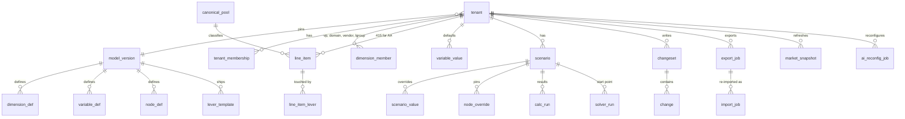

# 01 · Data model

Machine-readable version: `schema.json` (tables, columns, constraints, views, validation rules). This page explains the design.

## 1. Five rules

1. **Numbers are rows, not columns.** Every numeric input is a row in `variable_value` (tenant default) or `scenario_value` (scenario override), keyed by `(var_key, member_key)`. Entity tables hold only structure and categories (names, pool, domain, tags). This is what makes "every number editable" cheap: the UI, Excel import and solvers all write the same two tables.
2. **Formulas are data.** `node_def` stores expressions; `variable_def` stores input definitions; `dimension_def` stores dimensions. All three are versioned together in `model_version`. A tenant pins one version, so a formula change never silently changes a tenant's numbers.
3. **Tenant on every row.** Every tenant table has `tenant_id` with row-level security. Global tables (model versions, definitions, canonical pools, the lever library) are shared and read-only to tenants.
4. **Every write is a changeset.** UI edit, Excel import, solver result, AI reconfiguration and market refresh all create a `changeset` of `change` rows: audit trail, diff and one-click undo for free.
5. **Anything calculated can be pinned.** `node_override` replaces a calculated cell for one scenario (with a reason), e.g. "AA finance says the SI pool is $118M".

## 2. Entity map

## 3. Dimensions

| Dimension | Scope | AA members | Used for |
|---|---|---|---|
| `pool` | global (canonical) | 11: internal_labour, captive_labour, si_contingent, consulting, software, airline_platforms, cloud, dc_hardware, network, end_user, other | Every lever formula refers to canonical pools, so the library works for any airline. Tenants keep their own L1 labels. |
| `line` | tenant | 415 baseline lines | Bottom-up baseline |
| `domain` | tenant | 15 IT domains | Drives VP ownership |
| `vp` | tenant | 4 (Commercial, Operations, Corporate, Infra & All Others) | Org lens. Add or rename freely; no fixed slots. |
| `lever` | global library + tenant | L01–L17 | Savings levers |
| `akey` | system | pools + apps + blend | Lever-to-VP allocation key |
| `vendor` | tenant | 6 preferred SIs | Tail-SI calculation |
| `addr_tag` | global | locked, partly, addressable | Addressability |
| `year` / `iyear` | system | FY25, FY26, FY27 base, FY27 + IT / FY25–27 | Corporate model |
| `lgroup` | tenant | 5 labor groups | Corporate labor cost |

`member_key` is the comma-joined member ids in the variable's dimension order: `''` for scalars, `'L05'`, `'pilots,fy27'`, `'commercial_applications,vp_infra'`.

## 4. How a scenario resolves

`v_inputs_resolved(tenant, scenario)` = variable definition → tenant default → parent scenario → this scenario, last one wins; plus this scenario's node overrides. The engine loads that view and the dimension members, nothing else.

Presets (Rates only, A, B, C, D) are locked scenarios. Users copy one to edit. Solver results are saved as new scenarios with `kind = solver`. The default is C.

## 5. Concurrency, history and caching

- `scenario.version` bumps on every applied changeset; writes carry the version they started from (optimistic locking).
- `calc_run` caches outputs by `input_hash` (hash of the resolved inputs and the model version); repeated views are free.
- Undo = apply the reverse changeset. History = list of changesets per scenario.

## 6. Validation

Enforced on every changeset (UI, import, API, AI). Full list in `schema.json → validation_rules`:
- Domain ownership sums to 100% per domain; exactly one shared-services VP when chargeback is on; usage keys sum to 100% when overridden.
- Values within registry min/max (UI clamps; import flags).
- Managed services ≥ 0 (contractor T&M cost cannot exceed the SI pool).
- App-retirement split ≤ 100%; apps retired ≤ portfolio size.
- Engine self-tests: pool effects sum to each lever's run-rate; VP nets sum to total.

## 7. What the AA seed contains

`seed/aa/`: `tenant.json`, `dimension_members.json` (pools, 415 lines with all baseline attributes, domains, VPs, levers, vendors, labor groups, years), `variable_values.json` (every input's AA default), `scenarios.json` (five presets), `lever_library.json` (hypothesis, mechanism, benchmarks, risks per lever). Loading these into the tables above gives a working AA tenant.
