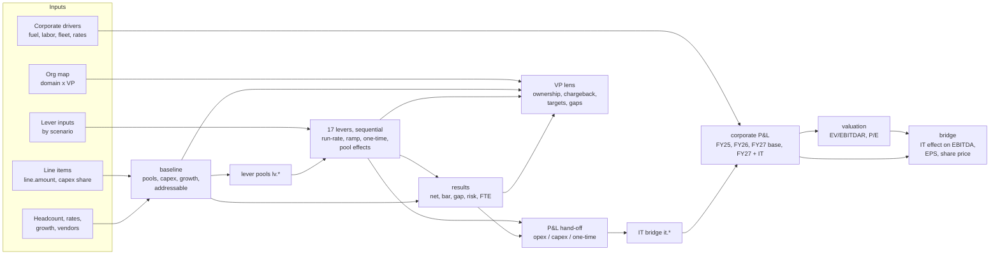

# 03 · Formula graph

The whole model, from 415 baseline lines to AA's share price, is one directed acyclic graph of **307 formula nodes** over **194 input variables**, stored as data in `formula_graph.json` and `variables.json`. Expanded over its dimensions it is about 3,400 calculated cells. No formula lives in application code, so reconfiguring for another airline means changing data, not logic.

The reference engine (`reference/engine.py`, ~300 lines, no airline knowledge) reads only these JSON files and a tenant seed. It reproduces the three existing models to rounding (245 of 245 checks, `reference/parity_report.json`).

## 1. Layers

| Layer | Nodes | What it does | Key outputs |
|---|---|---|---|
| baseline | 18 | Scales lines by headcount, sums them into 11 canonical pools | `base.total` 1,007.6, `base.capex_total` 123.9, `base.headwinds` 43.0, `base.locked_share` 20.8% |
| levers (pools) | 25 | Derives what the levers act on (cost per head, managed services, tail SI, Microsoft share, DC split) | `lv.us_cost`, `lv.ms0`, `lv.tail` |
| levers | 71 | 17 levers in fixed order, each on the pool left by earlier levers; ramp; one-time; pool effects | `lev.rr`, `lev.iy`, `lev.ot`, `lev.eff`, `lev.cx` |
| results | 22 | Totals, target, bar, gap, risk, end-state FTE | `res.net`, `res.bar`, `res.gap`, `res.risk` |
| pnl | 19 | Opex / capex / one-time split by year (replaces `pnl_feed.json`) | `pnl.o27`, `pnl.c27`, `pnl.e27` |
| vp | 25 | Ownership from domains, chargeback of shared pools, proportional targets, VP gaps | `vp.target`, `vp.net`, `vp.gap` |
| it_bridge | 18 | Feeds the active scenario into the corporate model (risk factor, SWB split, special items) | `it.opex27`, `it.swb27` |
| corporate | 79 | Driver P&L, cash flow and net debt for FY25, FY26, FY27 base and FY27 + IT | `pl.eps`, `pl.ebitda`, `pl.net_debt` |
| valuation | 8 | EV/EBITDAR and P/E prices on the two FY27 columns | `val.px` |
| bridge | 22 | Pure IT effect (FY27 + IT minus FY27 base) and the FY28 run-rate | `br.eps27`, `br.px27`, `br.eps28` |

The full node list with every expression is in `03b_node_catalogue.md`.

## 2. Expression language

Small, Excel-like, and easy to implement in TypeScript or SQL. The reference parser is a ~100-line Pratt parser.

| Construct | Example | Notes |
|---|---|---|
| Arithmetic, comparison | `a * (1 - b) / 12`, `x >= 0` | Comparisons return 1 or 0. `^` is power. |
| Functions | `IF(c, a, b)`, `MIN`, `MAX`, `ABS`, `AND`, `OR`, `NOT`, `SAFEDIV(a, b, alt)` | `IF` is lazy. `SAFEDIV` returns `alt` (default 0) on a zero divisor. |
| Aggregates | `SUM(l in line where l.pool == pool, base.line_outlay[l])` | Also `COUNT`, `MAXOVER`, `MINOVER`. `where` may only use dimension attributes and bound variables (static), so dependencies are known at load time. |
| References | `lev.rr[lever]`, `corp.gdp[year.in]`, `pool.growth['software']` | Index by a bound dimension variable, an attribute of one, or a member literal. |
| Implicit index | `lev.rr * lev.ramp_factor` in a node with dims `[lever]` | A dimensioned symbol without `[]` is indexed by the innermost bound variable of each of its dims. |
| Bound variables | `pool == 'software'`, `year.it`, `l.domain` | A node's dims bind variables named after the dims; aggregates bind their own (`l`, `p`, `u`). A bare variable evaluates to its member id; `.attr` reads a member attribute. Symbol ids win over attribute access. |
| Piecewise by member | `cases: [{when: {year: ['fy25']}, expr: 'corp.asm25'}, {when: null, expr: 'pl.asm[year.prev] * (1 + corp.asm_g[year.in] / 100)'}]` | First matching case wins. Used for base years and for per-lever formulas. |
| Member subsets | `members: {year: ['fy27b', 'fy27it']}` | Expand a node only over some members (valuation). |

Engine rules:
1. **Expand** each node over the cartesian product of its dims (or `members` subset), choose the case, parse once, collect dependencies.
2. **Topologically sort** the cells; a cycle is a load-time error (none exist; interest income uses opening cash to avoid the usual circularity).
3. **Evaluate** in order. A **node override** (pin) replaces a cell's value, so any calculated number can be typed over in the UI or Excel.
4. **Incremental recalculation**: on a change, re-evaluate only cells downstream of the changed inputs (`Model.rerun`). Slider moves touch a few hundred cells.
5. **Vectorised mode** (for Monte Carlo and gradients): every expression is elementwise, so the same graph can evaluate N input vectors at once (`IF` becomes `where`).

Cell keys are `node_id[member,member]`, matching `variable_value.member_key` in the database.

## 3. The math, layer by layer

Money is $M. Positive means a saving. Pool ids are canonical (`internal_labour`, `captive_labour`, `si_contingent`, `consulting`, `software`, `airline_platforms`, `cloud`, `dc_hardware`, `network`, `end_user`, `other`).

### 3.1 Baseline
- Line outlay = `line.amount × scale`, where scale = `hc.us / hc.us_seed` for US labour lines, `hc.gcc / hc.gcc_seed` for GCC lines, `hc.ctr / hc.ctr_seed` for long-tail SI and staff-aug lines, else 1.
- Pool outlay, capex, addressable (outlay × `addr.share[tag]`) and growth (outlay × `pool.growth[pool]`) are sums over the pool's lines.
- `base.headwinds` = Σ pool growth = **$43.0M**. Locked share = 20.8%.

### 3.2 Lever pools
- `lv.us_cost = pool(internal_labour) / hc.us`, `lv.gcc_cost = pool(captive_labour) / hc.gcc`.
- Contractors: onshore FTE = `hc.ctr × hc.ctr_on_share`; cost per FTE = hourly rate × billable hours. Managed services `lv.ms0 = SI pool − contractor T&M cost`. Tail SI = SI pool − Σ preferred vendor book.
- Microsoft software = software × `sub.sw_ms_share`. DC: capex from lines; opex split into maintenance (`sub.dc_maint_share`) and colo.

### 3.3 Levers (sequential, no double counting)
Each lever acts on what earlier levers left. Order: 1 demand → 2 consulting → 3 onshore relocation → 4 SI-to-GCC → 5 US workforce → 6 AI productivity → 7 tail SI → 8 rate cards → 9 app retirement → 10 software → 11 cloud → 12 DC → 13 network → 14 end-user → 15 platforms → 16 invoice audit → 17 cost-increase containment (acts on growth, not the base).

Examples (full set in 03b):
- L01: `f = on × (change_share × cut + (1 − change_share) × rel)`; `rr = f × (on0·on_cost + off0·off_cost + ms0)`; residual pools shrink by `(1 − f)`.
- L03: `h = on × on1 × pct`; `rr = h × (on_cost − gcc_cost × prod_factor)`.
- L05: `rr = (h + r) × us_cost + us_total × (sl + vac) − (h × bf + r) × gcc_cost × prod_factor`.
- L08: `rr = ext8 × cov × cut × (1 − leak)` on the SI spend left after levers 1–7.

Common to every lever:
- Effective start `e = MAX(1, start − head_start)`; ramp factor `= IF(13 − e ≤ R, (13 − e)(14 − e) / 2R, (R + 1)/2 + (13 − e − R)) / 12` (linear ramp over R months).
- In-year `iy = rr × ramp × realize` (`realize` = 1 except in Monte Carlo). Confidence-weighted `iy × conf`.
- **Pool effects** `lev.eff[lever, pool]` split each run-rate across the pools it touches (relocation saves SI cost and adds GCC cost). Self-test `lev.rr_check` = 0.
- Capex share `lev.cx` = Σ effect × pool capex share / rr (lever 12: refresh deferral only). SWB part = Σ effect on employee pools × (1 − capex share).

### 3.4 Results
- One-time: all × `g.ot_in_year` = P&L charge; × (1 − `g.ot_out_share`) = charged to IT.
- **Net** = in-year gross − one-time charged to IT. **Bar** = target + `g.absorb_growth` × headwinds = $143.0M. **Gap** = net − bar. Risk-adjusted = Σ iy·conf − one-time on IT.
- Target = `g.target_net`, or `g.target_pct × base.total` when `g.target_mode = 2` (handy for other airlines).

### 3.5 VP lens
- Ownership `vp.alloc[vp, pool]` = Σ line outlay × `org.dom_share[line.domain, vp]` / pool.
- Chargeback (if on): for shared pools, the shared-services VP's slice is re-credited to all VPs by usage key (default = share of non-shared spend owned; or metered override).
- Effective addressable moves with the credit. Proportional target: `(target + Σ growth) × eff_addr / Σ eff_addr − own growth`; equal; or manual.
- Lever share per VP: by the lever's allocation key (v0.3) or by its pool effects. VP net = Σ iy × share − one-time on IT × share. VP gap = net − (target + own growth).

### 3.6 P&L hand-off and corporate model
- `pnl.o27 = Σ iy × (1 − cx)`, `pnl.c27 = Σ iy × cx`, EBITDA = opex savings − all one-time, D&A relief = capex saved / life × 0.5, CY28 at run-rate.
- The corporate model runs four columns. FY27 base and FY27 + IT share every input; only IT lines differ (test: revenue identical). IT opex savings split into SWB and other opex; one-time costs sit in other opex or special items (`corp.it_ot_si`); capex savings cut capex, raise cash and lower net debt; D&A relief lowers non-aircraft D&A; profit sharing (5%) leaks part of the gain.
- Price = EV/EBITDAR × multiple − net debt, per share (P/E blend optional, auto-off if EPS ≤ 0). Bridge = FY27 + IT minus FY27 base.

## 4. Reference results (unified defaults, AA)

| Scenario | Gross CY27 | One-time on IT | **Net** | Risk-adj. | Gap to $143.0M | Run-rate | EPS 2027 | Share price |
|---|---|---|---|---|---|---|---|---|
| Rate cuts only | 8.3 | 0.1 | **8.1** | 5.8 | −134.9 | 10.1 | +$0.007 | +$0.08 |
| A Commercial | 126.3 | 13.1 | **113.2** | 81.1 | −29.8 | 168.1 | +$0.094 | +$1.04 |
| B Op-model reset | 116.9 | 22.7 | **94.1** | 60.4 | −48.9 | 171.9 | +$0.062 | +$0.70 |
| C Balanced | 138.8 | 19.6 | **119.3** | 82.0 | −23.7 | 193.8 | +$0.091 | +$1.02 |
| D Full stretch | 201.3 | 34.4 | **166.9** | 112.1 | +23.9 | 283.7 | +$0.117 | +$1.31 |

VP gaps in C (chargeback on): Commercial −4.9, Operations −6.9, Corporate −3.0, Infra & All Others −9.0. All per-lever and per-VP values are in `reference/golden_results.json`; the app's engine must match them to 1e-6 relative.

Unified vs v0.3 in C: net +$0.1M (pools now from lines), opex −$2.8M / capex +$2.9M (capex shares now from lines), EPS −$0.003. See 06.

## 5. Contract for the app's calc engine
- Load `formula_graph.json` + `variables.json` for the tenant's pinned `model_version`, and members/values from the database views.
- Same semantics as `reference/engine.py`. Port it rather than re-deriving the math.
- Pass `reference/run_tests.py` (parity) and match `golden_results.json` in CI.
- Expose `evaluate`, `rerun(changes)`, `evaluate_batch(N vectors)` and dependency queries (what feeds this number, what this input moves) for explainability in the UX.
